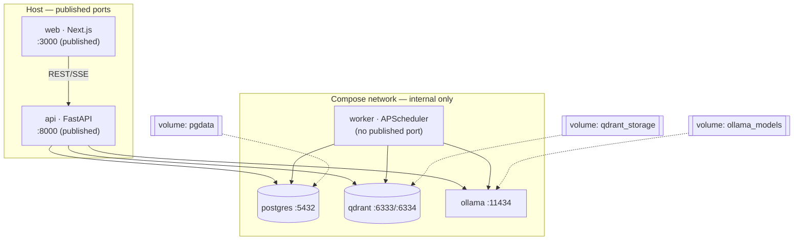
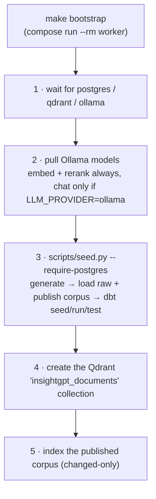

# 09 — Deployment

This document describes how InsightGPT is packaged, configured, brought up, and
moved to the cloud. The design goal is the one stated in
[`00-overview.md`](00-overview.md): **the full system comes up with a single
`docker compose up`** from the repo root, and the same artifacts deploy to a
cloud host with documented, minimal changes.

Related reading: architecture and topology in
[`01-architecture.md`](01-architecture.md); the security posture that constrains
network exposure and secrets in [`08-security.md`](08-security.md); test/CI in
[`10-testing-eval.md`](10-testing-eval.md).

## 1. Docker Compose topology

Six services, wired on a private compose network. Only `web` and `api` publish
ports to the host; the data/model services are internal only (see
[`08-security.md`](08-security.md) §7).



### 1.1 Services

| Service | Image / build | Role | Published? |
|---|---|---|---|
| **web** | `docker/web.Dockerfile` (Next.js) | Frontend UI | Yes — `${WEB_PORT}:3000` |
| **api** | `docker/api.Dockerfile` (FastAPI/uvicorn) | REST + SSE, insight engine, auth | Yes — `${API_PORT}:8000` |
| **worker** | `docker/worker.Dockerfile` | APScheduler jobs, pipeline runs, ingestion, dbt invocations | No |
| **postgres** | `postgres:16` | Warehouse (`raw`/`staging`/`marts`) | No |
| **qdrant** | `qdrant/qdrant` | Vector DB | No |
| **ollama** | `ollama/ollama` | Local embeddings, rerank, default LLM | No |

`api` and `worker` are **separate images** built from the same repo root
context. They need genuinely different dependency sets — the API carries the web
stack, the worker carries dbt-postgres, the ingestion package, and the retrieval
indexer — and keeping them apart means neither image ships a dependency it never
calls. What is shared is the source, not the image: `services/ingestion`,
`services/retrieval`, `config/`, and the semantic layer are single definitions
copied into whichever image needs them.

### 1.2 Volumes (persistent state)

| Volume | Backs | Notes |
|---|---|---|
| `pgdata` | Postgres data dir | The warehouse — the durable source of truth |
| `qdrant_storage` | Qdrant storage | Vectors + payloads; rebuildable from documents |
| `ollama_models` | Pulled model blobs | Avoids re-downloading models on every restart |
| `generated_data` | `worker:/app/data/generated` (rw), `api:…:ro` | The synthetic CSVs + document JSON `scripts/seed.py` writes |
| `ingested_data` | `worker:/app/data/ingested` (rw), `api:…:ro` | The redacted document corpus handed to retrieval, plus its index state |

The last two exist because `make bootstrap` and `make seed` run in a throwaway
`docker compose run --rm worker` container, while the scheduler that reindexes
from that corpus is the long-running `worker` service. Without shared volumes
the corpus would die with the container that produced it and every scheduled
`reindex_docs` would fail with "document corpus not found". They are mounted at
the two output directories rather than at `/app/data`, so the baked-in
`data/generator` package stays visible.

The `api` service mounts both **read-only**. `GET /sources` reports on the
generator's CSV extracts and on the corpus (`GENERATED_DIR` and
`DOCUMENT_CORPUS_PATH`), so without the mounts the source registry rendered
every file-backed source as missing while the worker held the data — a
confusing failure, because nothing was broken except the API's view of the
disk. Read-only because writing is the worker's job: ingestion and dbt run
there, and the API is a query path that should not be able to rewrite the
corpus it cites.

`qdrant_storage`, `generated_data`, and `ingested_data` are all **rebuildable**
(re-seed, re-index), but `pgdata` for a real deployment is not — back it up
(Section 6).

### 1.3 Healthchecks & dependencies

Where a healthcheck can be written, dependents wait for *readiness* rather than
container start:

| Service | Healthcheck | Why this probe |
|---|---|---|
| **postgres** | `pg_isready -U $POSTGRES_USER -d $POSTGRES_DB` | Ships in the image |
| **ollama** | `ollama list` | Same daemon as `GET /api/tags`, and the binary is always present |
| **api** | `python -c` urllib `GET http://localhost:8000/health` | `python` is always in the image; no curl needed |
| **worker** | `python -c` urllib `GET http://localhost:8090/health` | A stdlib health server on an internal-only port |
| **qdrant** | **none** | See below |
| **web** | **none** | Nothing depends on it |

**qdrant deliberately has no healthcheck.** The official image is distroless: it
contains no shell and no curl, so a `CMD-SHELL` or curl probe can never pass and
would leave the container permanently `unhealthy`, blocking every dependent
forever. Dependents therefore use `condition: service_started` and rely on their
own connection retries — plus `scripts/bootstrap.py`, which polls
`GET /readyz` from the worker (where `httpx` *is* installed) before doing
anything that needs Qdrant. That is a real readiness gate; it just lives in the
client rather than in the container.

So: `api` and `worker` wait on `postgres: service_healthy`,
`ollama: service_healthy`, and `qdrant: service_started`; `web` waits on
`api: service_healthy`.

## 2. Configuration

Configuration follows the **config-driven, no-hardcoded-ports** principle from
[`01-architecture.md`](01-architecture.md) §1:

- **`config/*.yaml`** — non-secret, environment-independent settings: semantic
  layer definitions, retrieval parameters (chunk sizes, top-k, rerank), model
  names, pipeline schedules. Checked into the repo.
- **`.env`** (gitignored) — secrets and per-deployment values. A committed
  **`.env.example`** documents every variable. No secrets in the repo or the
  vector store (see [`08-security.md`](08-security.md) §6).
Ports are not hardcoded in any service: `WEB_PORT` and `API_PORT` set what the
host publishes, and `NEXT_PUBLIC_API_URL` tells the frontend where to find the
API (including the `/api/v1` prefix — the value must carry that suffix, and it
does in both `.env.example` and the compose build args).

### 2.0 Two topologies, one `.env`

There are two ways to run InsightGPT, and the difference is **which hostnames
resolve**. Getting this wrong is the single most common setup failure, because
neither form errors — a URL that does not resolve looks exactly like a service
that is down.

| | **Host run** (the demo path) | **Compose run** (`make up`) |
|---|---|---|
| What runs where | API + web as host processes (`uv`, `npm`); Qdrant and Ollama are services you already run on this machine | Six containers on a private compose network |
| Qdrant | `http://127.0.0.1:6333` | `http://qdrant:6333` |
| Ollama | `http://127.0.0.1:11434` | `http://ollama:11434` |
| Warehouse | `WAREHOUSE=duckdb` (the offline retail fixture) | `WAREHOUSE=postgres` (the `postgres` sibling) |
| Published at | `http://localhost:3000` / `:8000` | `http://localhost:3000` / `:8000` |
| Brought up by | `make preflight` to check, then the two dev servers (`run.ps1` does both on Windows) | `make up` + `make bootstrap` |

`.env` is written for the **host run**: `127.0.0.1` everywhere and
`WAREHOUSE=duckdb`. The compose topology does not inherit those values. The
three variables that differ by topology read a `STACK_`-prefixed override in
`docker/compose.yml` and otherwise keep the service-name default:

| In `.env` (moves the host run) | In `docker/compose.yml` (moves the compose run) | Compose default |
|---|---|---|
| `QDRANT_URL` | `STACK_QDRANT_URL` | `http://qdrant:6333` |
| `OLLAMA_HOST` | `STACK_OLLAMA_HOST` | `http://ollama:11434` |
| `WAREHOUSE` | `STACK_WAREHOUSE` | `postgres` |

So one `.env` serves both and there is nothing to edit when switching. Every
other variable means the same thing in both and is interpolated normally —
including `QDRANT_COLLECTION`, because the collection name is a property of the
data, not of the topology.

Set `STACK_QDRANT_URL` when the containerised stack should talk to a Qdrant
outside the compose network (a managed instance, or the same loopback Qdrant the
host run uses — on Docker Desktop that is
`http://host.docker.internal:6333`, not `127.0.0.1`, which inside a container
means the container itself).

**Check it rather than assume it.** `python scripts/setup.py --preflight`
(`make preflight`) reads `.env`, then verifies against reality: Qdrant answers,
the collection exists and its vector width matches `EMBED_DIMENSIONS`, Ollama is
up with both required models pulled, and the provider key is present and
accepted. It prints a fix beside every failing line and exits non-zero. It is
**read-only** — every call it makes is a `GET`, and it never creates, deletes or
"tidies" anything (see §2.3).

### 2.1 Reading `.env`: use `make up`, or run compose from the root

Compose derives its **project directory** from the first `-f` file and loads
`.env` from *that* directory. So:

```bash
make up                                       # correct — passes --env-file .env
docker compose up --build                     # correct — root compose.yaml
docker compose -f docker/compose.yml up       # WRONG — reads no .env at all
```

The wrong form does not error. It silently falls back to every in-file default,
so a deployment configured for `LLM_PROVIDER=openai` comes up on ollama with no
message. Two things make it hard to hit: the `Makefile` always passes
`--env-file .env`, and the repo root has a `compose.yaml` that `include:`s
`docker/compose.yml` (pinning the same project name, `insightgpt`, so both
routes manage the same containers and volumes) — which makes the repo root the
project directory and the root `.env` the one that gets read.

### 2.2 Key environment variables (`.env.example`)

```dotenv
# --- Ports (host-published; override to avoid conflicts) ---
WEB_PORT=3000
API_PORT=8000

# --- Database ---
# Empty ships on purpose: compose substitutes its own identical defaults for an
# empty value, while a host run on WAREHOUSE=duckdb would otherwise register the
# unresolvable `postgres` host as a data source.
POSTGRES_DSN=
APP_POSTGRES_DSN=
POSTGRES_HOST=postgres
POSTGRES_PORT=5432
POSTGRES_DB=insight
POSTGRES_USER=insight
POSTGRES_PASSWORD=insight

# --- Auth ---
JWT_SECRET=                        # openssl rand -hex 32

# --- Vector DB (host-run values; compose uses its own — §2.0) ---
RETRIEVER=qdrant                   # `fixture` cannot see an uploaded dataset
QDRANT_URL=http://127.0.0.1:6333
QDRANT_COLLECTION=insightgpt_documents   # the ONE collection we own (§2.3)

# --- Local models (Ollama): embeddings + reranking, always local ---
OLLAMA_HOST=http://127.0.0.1:11434
EMBED_PROVIDER=ollama              # `openai` sends document text off the machine
EMBED_MODEL=nomic-embed-text
EMBED_DIMENSIONS=768               # must match the collection; changing it = re-index
RERANK_MODEL=dengcao/Qwen3-Reranker-0.6B:F16

# --- LLM provider (chat/reasoning step only) ---
APP_ENV=production                 # refuses a config that cannot serve users
LLM_PROVIDER=gemini                # gemini | openai | groq (cloud) | ollama | fake
LLM_MODEL=gemini-2.5-flash         # pin it: provider catalogues get retired
GEMINI_API_KEY=                    # only if LLM_PROVIDER=gemini
# OPENAI_API_KEY=                  # only if LLM_PROVIDER=openai
# GROQ_API_KEY=                    # only if LLM_PROVIDER=groq
LLM_MAX_OUTPUT_TOKENS=2048         # cost ceiling for one reasoning call
LLM_TIMEOUT_S=60
LLM_MAX_RETRIES=3

# --- Pipeline ---
REINDEX_SOURCE=ingested            # ingested | samples | <path>

# --- Frontend ---
NEXT_PUBLIC_API_URL=http://localhost:8000/api/v1
# Every origin the browser loads the web app from. The 3020 entries cover the
# native (no-Docker) dev flow; an origin missing here fails CORS preflight and
# login stops working in the browser with no server-side error.
CORS_ORIGINS=http://localhost:3000,http://127.0.0.1:3000,http://localhost:3020,http://127.0.0.1:3020
```

`.env.example` is the authoritative list; the block above is a summary.

**Two database roles.** `docker/initdb/01-schemas.sql` provisions the owner
role `insight` (it owns `raw`, `marts`, and `insight`, and is what dbt,
ingestion, and the seed job connect as) plus a second login role `insight_app`
that holds only `CONNECT`, `USAGE`, and `SELECT` on `marts` and `insight` — with
a narrow `INSERT, UPDATE` grant on `insight.pipeline_runs` so run tracking still
works. The `api` service connects as that read-only role: compose maps
`APP_POSTGRES_DSN` onto the container's `POSTGRES_DSN`, while the `worker`
keeps the owner `POSTGRES_DSN` because dbt must create tables. So a failure of
the SQL guardrails still cannot write to the warehouse. The guarantees above
the database remain the first line of defence: the engine never authors SQL,
the query builder compiles only from the governed semantic layer, and the table
allow-list rejects anything outside `marts` (see
[`08-security.md`](08-security.md) §3).

**Cloud keys** reach the `api` container only if they are in the root `.env`
*and* the stack was started a way that reads it (§2.1). Embeddings and reranking
use local Ollama models regardless of `LLM_PROVIDER` — only the chat/reasoning
step follows it, and only `EMBED_PROVIDER` (§2.5) can move embedding off the
machine. `gemini` is the configured default and goes through Google AI Studio's
OpenAI-compatible endpoint, so it shares the provider class with OpenAI and
Groq; a cloud provider with no key raises at startup naming the variable.

**What is local and what is not**, stated precisely, because the distinction is
easy to overclaim: document text is chunked, redacted and embedded on this
machine, and the vectors and chunk text are stored in a Qdrant on this machine.
The **snippets retrieved for a question are sent to the reasoning provider** as
part of the prompt — with `LLM_PROVIDER=gemini` that means those snippets go to
Google. Nothing else about a document leaves the machine. Setting
`LLM_PROVIDER=ollama` keeps the reasoning step local too, at the cost of answer
quality on a CPU-only box.

### 2.3 One collection, on an instance we may not own

InsightGPT uses exactly one Qdrant collection, named by `QDRANT_COLLECTION`
(default `insightgpt_documents`). The name is deliberately namespaced, and the
namespace is enforced in code rather than remembered:

- `scripts/bootstrap.py` refuses to run when `QDRANT_COLLECTION` does not start
  with `insightgpt_`, before it creates or writes anything.
- `scripts/setup.py --preflight` fails on the same condition, and having
  refused the name does not go on to probe that collection.
- The retrieval package asserts the prefix before any delete, and dataset
  deletion is a **filtered delete on `dataset_id`** — never a collection drop
  (see [`04-retrieval-rag.md`](04-retrieval-rag.md) §7).

This is not hypothetical tidiness. A developer Qdrant is routinely shared: the
instance on the maintainer's machine also holds another project's `code`, `docs`
and `memory` collections. Indexing into one of those would not error — it would
silently overwrite that project's points — and a `recreate_collection` or a
"clean slate" prune would destroy them outright. So nothing in this repo issues
a drop, reset or prune against a collection outside the prefix, and
`make clean` (which *does* delete data) only ever touches the **compose**
project's own `qdrant_storage` volume, not an instance you brought yourself.

### 2.4 Production mode (`APP_ENV=production`)

Setting `APP_ENV=production` turns three soft defaults into hard contracts.
All three exist because the alternative is a deployment that *looks* healthy
and is not.

**The API refuses to boot on a configuration that cannot serve users.** A
cloud provider with no key, or `LLM_PROVIDER=fake`, raises at startup naming
the variable to set. Without this, a deployment that forgot `GEMINI_API_KEY`
passes its health check, serves the UI, and fails on the first real question —
usually in front of whoever is being shown the system.

**An unreachable model is a `503`, never a templated answer.** See
[`05-insight-engine.md`](05-insight-engine.md) §7.3 for why this product in
particular cannot degrade quietly.

**A single reasoning call is bounded.** `LLM_MAX_OUTPUT_TOKENS` (default 2048)
caps the bill per answer, `LLM_TIMEOUT_S` (60) caps the wait, and
`LLM_MAX_RETRIES` (3) caps the amplification of a provider outage. An
unbounded completion against a metered API is an unbounded invoice.

| Variable | Default | Why it matters |
|---|---|---|
| `APP_ENV` | unset | `production` enables the three contracts above |
| `LLM_PROVIDER` | `ollama` | `gemini` \| `openai` \| `groq` \| `ollama` \| `fake` |
| `LLM_MODEL` | per provider | **Pin it.** Catalogues are retired on a schedule |
| `GEMINI_API_KEY` | — | Required when `LLM_PROVIDER=gemini` |
| `LLM_MAX_OUTPUT_TOKENS` | `2048` | Cost ceiling for one answer |
| `LLM_TIMEOUT_S` | `60` | Latency ceiling |
| `LLM_MAX_RETRIES` | `3` | Retries on 429/5xx only, with jittered backoff |
| `LLM_MAX_TOKENS_FIELD` | `max_tokens` | `max_completion_tokens` for OpenAI reasoning models |

> **One ceiling, one field name.** Gemini answers `400 max_tokens and
> max_completion_tokens cannot both be set`, so sending both spellings to
> "cover either" fails every call. Verified against the live endpoint.

### 2.5 Embeddings on a host without Ollama

`RETRIEVER=qdrant` needs something to turn text into vectors. The default is a
local Ollama model, which a managed host usually has nowhere to run — and
without an embedder the retriever falls back to `fixture`, which is keyword
overlap. That matters more than it sounds: the product presents hybrid dense
retrieval with reranking, so a deployment quietly running keyword matching is
making a claim it is not meeting.

`EMBED_PROVIDER=openai` points the embedder at any OpenAI-compatible
`/embeddings` endpoint (the same Gemini key already configured above works):

```bash
EMBED_PROVIDER=openai
EMBED_API_KEY_ENV=GEMINI_API_KEY
EMBED_MODEL=gemini-embedding-001
EMBED_DIMENSIONS=3072      # must match the collection; changing it = re-index
```

Two failure modes are refused rather than absorbed, because both are otherwise
invisible:

- **Width mismatch.** A model returning 3072-d vectors against a collection
  built for 768 would corrupt it. The first call fails, naming the number to
  set.
- **Prefix carry-over.** The `search_document:` / `search_query:` prompts are
  specific to the nomic-style Ollama models; sent to a cloud model they embed
  those literal words into every passage and cost recall without erroring.
  They are cleared automatically for a non-Ollama provider.

Note that `qdrant` also needs a reachable Qdrant. On a single-container host
that means a managed instance, not a sibling service.

---

**Checking it is actually working.** `GET /system/status` (admin) asks the
provider for its `/models` list and reports whether the configured model is
still in it. This is the check that catches the failure mode a key-presence
check cannot: a model id that was valid on the day you deployed and has since
been retired.

---

## 3. One-command bring-up & first-run bootstrap

```bash
make env                  # copies .env.example -> .env (edit secrets)
make up                   # builds and starts the stack
make bootstrap            # first run only: models, warehouse, index
```

Bootstrap is a **separate, explicit command**, not something the worker
entrypoint does on boot. That is deliberate: it pulls gigabytes of models and
rebuilds the warehouse, which is not something a container restart should
silently trigger. It is **idempotent** — every step checks state before acting —
so re-running after a partial failure is the normal recovery path.

The database schemas are not bootstrap's job either: `docker/initdb/01-schemas.sql`
runs once when Postgres initializes an empty volume and creates `raw`, `marts`,
`insight`, and `insight.pipeline_runs`.



The five steps, and what each one really does:

1. **Wait for postgres / qdrant / ollama.** Postgres via a real `SELECT 1`,
   the other two via HTTP polling, each with a 120 s deadline and an actionable
   message on timeout.
2. **Pull Ollama models.** The embedding and reranker models always — they are
   local by default, and the cloud embedding path (§2.5) is opt-in. The **chat
   model only when
   `LLM_PROVIDER=ollama`**, since pulling several gigabytes for a model an
   openai/groq deployment will never call is pure waste. Already-present models
   are skipped. A pull is retried up to three times: long pulls over a flaky
   registry connection die with an incomplete chunked read, and Ollama keeps the
   blobs it already fetched, so a retry resumes rather than restarts. The stream
   is parsed rather than drained — Ollama reports a mid-pull failure as an
   `error` event on a `200` response — and the model must then actually appear
   in `/api/tags` before the step reports success.
3. **Build the warehouse.** Delegates to `scripts/seed.py`, passing
   `--require-postgres` so that a database this step already proved reachable
   cannot be quietly skipped. Seed generates the dataset, loads `raw`, publishes
   the redacted document corpus, then runs dbt `seed` + `run` + `test`
   ([`10-testing-eval.md`](10-testing-eval.md) §3).
4. **Create the collection named by `QDRANT_COLLECTION`** — skipped if it
   exists. An unreachable Qdrant fails the step instead of being mistaken for a
   first run, and a `QDRANT_COLLECTION` outside the `insightgpt_` namespace
   aborts the whole run before step 1 (§2.3).
5. **Index the corpus step 3 published.** Not the built-in demo documents: the
   real ones. There is no "skip if the collection is non-empty" shortcut here
   because indexing is changed-only — a re-run over an unchanged corpus
   re-embeds nothing anyway, whereas skipping on "has points" would ignore
   documents that *did* change.

There is no `bootstrap_complete` marker; each step's own state check is what
makes a re-run cheap.

## 4. Local development workflow

Docker Compose is the integration path; day-to-day development runs services
individually against data stores already on the machine (§2.0, host run).

### 4.0 Clean machine to working demo

Six steps, in order. Each one is checkable, so a failure names itself instead of
surfacing three steps later.

1. **Install the prerequisites.** Python 3.12 + [uv], Node 20+, and either
   Docker Desktop (to run Qdrant in a container) or a Qdrant binary. Ollama
   from [ollama.com](https://ollama.com).
2. **Start the two local services.** Qdrant on `127.0.0.1:6333` and Ollama on
   `127.0.0.1:11434`. If they are already running for another project, use
   them — InsightGPT shares the instance safely (§2.3).
3. **Pull the two local models**, roughly 1.5 GB in total:

   ```bash
   ollama pull nomic-embed-text
   ollama pull dengcao/Qwen3-Reranker-0.6B:F16
   ```

4. **Configure.** `python scripts/setup.py --native` creates `.env` from
   `.env.example` (generating a real `JWT_SECRET`) and installs the Python and
   web dependencies. Then paste a [Google AI Studio key] into
   `GEMINI_API_KEY=`. It is blank on purpose: the API refuses to start on a
   cloud provider with no key, which is a readable failure at boot rather than
   a 503 in front of an audience.
5. **Verify before relying on it.**

   ```bash
   make preflight          # or: python scripts/setup.py --preflight
   ```

   Every line is a pass or a fail with its fix: Qdrant reachable, the collection
   present (or "not yet — created on first upload"), its vector width matching
   `EMBED_DIMENSIONS`, both Ollama models pulled, and `GEMINI_API_KEY` present
   *and accepted by the provider* with `LLM_MODEL` still in its catalogue. Add
   `--offline` to skip the one outbound call.
6. **Start the two processes** (or run `run.ps1` on Windows, which does both and
   runs the preflight first):

   ```bash
   cd services/api && uv run uvicorn app.api.main:app --port 8000
   cd web          && npm run dev                      # http://localhost:3000
   ```

Sign in as `admin@insightgpt.dev` / `admin-pass`, then upload a dataset on
**Sources** and ask a question about it on **Ask**
([`03-ingestion-etl.md`](03-ingestion-etl.md) §7.1).

The retail warehouse questions ("why did sales decline last quarter?") answer
from the DuckDB fixture in this mode; the Postgres warehouse and dbt models
need the compose stack.

[uv]: https://docs.astral.sh/uv/getting-started/installation/
[Google AI Studio key]: https://aistudio.google.com/apikey

### 4.1 Running a service at a time

- **Python (api, worker, ingestion, retrieval)** — each is its own **uv**
  project with its own `pyproject.toml` and virtualenv, so a change to one
  cannot drag another's dependencies along:

  ```bash
  cd services/api        && uv run uvicorn app.api.main:app --reload
  cd services/worker     && uv run python -m worker          # scheduler loop
  cd services/worker     && uv run python -m worker run reindex_docs   # one job
  cd services/retrieval  && uv run insight-retrieval index   # changed-only
  make test                        # every suite, in order
  make lint                        # ruff over every package
  ```

- **Web (Next.js)** — **pnpm** (npm works too):

  ```bash
  pnpm install
  pnpm dev                         # http://localhost:3000
  ```

- **Data stores only** — run just the backing services while developing app code
  on the host:

  ```bash
  docker compose up postgres qdrant ollama
  ```

  The host-run app reads `POSTGRES_DSN` / `POSTGRES_HOST`, `QDRANT_URL`, and
  `OLLAMA_HOST` from `.env`, so pointing it at container stores is a config
  change, not a code change. Two caveats, both of which look like an outage
  rather than a misconfiguration:

  - Only `postgres` publishes a host port (on loopback). The compose `qdrant`
    and `ollama` services are **internal-only**, so a host-run API cannot reach
    them until you uncomment the `qdrant` ports block in
    `docker/compose.yml` — or, more simply, point `QDRANT_URL` at a Qdrant you
    published yourself, which is what the default `127.0.0.1:6333` assumes.
  - That loopback Qdrant need not be the compose one. If another project
    already runs Qdrant on `6333`, use it: InsightGPT confines itself to its own
    `insightgpt_*` collection (§2.3).

- **dbt** — the project and the profile live in the same directory, and the
  profile reads `POSTGRES_*` from the environment (no secrets on disk):

  ```bash
  dbt build --project-dir services/warehouse --profiles-dir services/warehouse
  ```

  Or, end to end and tracked as a pipeline run:

  ```bash
  python -m worker run dbt_build
  ```

## 5. Cloud portability

The architecture is deliberately **cloud-portable** rather than cloud-specific.
This is a documented path, not a full IaC deliverable. Two shapes are supported.

### 5.1 Single VM (lift-and-shift)

The simplest cloud deployment is the same `docker compose up` on a VM:

- Provision a VM (e.g. 4 vCPU / 8–16 GB RAM), install Docker + Compose, clone the
  repo, set `.env`, run `docker compose up -d`.
- Put a reverse proxy (Caddy/Nginx) in front of `web` and `api` for TLS.
- **GPU note:** without a GPU, the local Ollama reasoning model will be slow.
  Either keep small local models for embeddings/rerank and switch
  `LLM_PROVIDER` to a cloud key for the heavy reasoning step, or size the VM
  accordingly.

### 5.2 PaaS (Render / Railway / Fly)

For a managed platform, decompose the compose file into managed pieces:

| Compose service | On PaaS |
|---|---|
| **postgres** | **Managed Postgres** (the provider's add-on). Point `POSTGRES_HOST` at it; run bootstrap/dbt as a one-off job. |
| **qdrant** | Qdrant as a container service **or** Qdrant Cloud. Point `QDRANT_URL` at it and add an API key (now that it is network-exposed — see [`08-security.md`](08-security.md) §7; the retrieval client does not read one today, so this is a change to make, not a setting to flip). |
| **ollama** | Usually **dropped** on GPU-less PaaS hosts. Set `LLM_PROVIDER` to a cloud key for reasoning; use a hosted/cloud embedding path or a small CPU embedding service for embeddings. |
| **api** | Stateless web service; scale horizontally (Section 7). |
| **worker** | Single background/worker instance (scheduler must be a singleton — Section 7). |
| **web** | Static/Node web service; point it at the public `api` URL. |

**What changes vs. local:** managed Postgres instead of the `postgres`
container; external Qdrant (with an API key) instead of loopback Qdrant; and —
because GPU-less hosts cannot run large local models well — a **cloud LLM key**
for the reasoning step. Everything reachable via config; no code changes.

**Resource notes:** api/worker are modest (CPU-bound on request handling and
embedding I/O). Postgres sizing tracks warehouse size. Qdrant memory tracks
vector count. The heavy compute is the reasoning LLM, which is why offloading it
to a cloud key is the standard PaaS adaptation.

## 6. Backup & restore

Two stores hold state; back up both, and treat backups as sensitive (see
[`08-security.md`](08-security.md) §9).

- **Warehouse (Postgres) — authoritative:**

  ```bash
  # backup
  docker compose exec postgres pg_dump -U "$POSTGRES_USER" -d "$POSTGRES_DB" -Fc > backup.dump
  # restore
  docker compose exec -T postgres pg_restore -U "$POSTGRES_USER" -d "$POSTGRES_DB" --clean < backup.dump
  ```

- **Vector data (Qdrant) — rebuildable:** use Qdrant **snapshots**
  (`POST /collections/{name}/snapshots`) for a fast restore, or simply
  **re-index** from `data/ingested/documents.json` (`make reindex`), which is
  literally the source of truth for the vectors. After a restore from elsewhere,
  delete the `.index_state.json` beside the corpus or run
  `insight-retrieval index --full` — the state file describes a collection that
  no longer exists, and changed-only would otherwise skip everything.

- **Config/secrets:** `.env` and `config/*.yaml` are backed up out-of-band by
  the operator (a secret store), never committed.

A restore drill is part of "done" for the deployment milestone: restore into a
clean environment and confirm the demo questions still answer correctly.

## 7. Scaling notes

- **api — horizontal.** The API is **stateless** (JWT auth, no server-side
  session). Run multiple replicas behind a load balancer; SSE streams are
  per-request and do not require sticky routing beyond the life of one stream.
- **worker — singleton.** The APScheduler worker **must run as a single
  instance**; two schedulers would double-fire pipeline jobs. Scale the *work*
  by making individual jobs heavier/parallel internally, not by adding scheduler
  replicas. (If HA is ever required, add a leader-lock — out of scope here.)
- **postgres / qdrant — vertical.** Scale the data stores up (CPU/RAM/disk)
  rather than out for this single-organization scope. Postgres read replicas and
  Qdrant sharding are possible later but unnecessary for the demo domain.
- **ollama / reasoning LLM — the real bottleneck.** On CPU it is the slow step;
  the pluggable provider means quality/throughput can be raised by pointing at a
  cloud key without touching application code.
